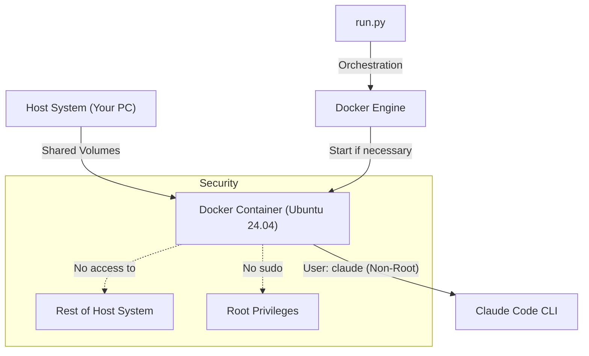

# 🛡️ Private Claude Code Environment

A secure, isolated Docker environment to run Claude Code (Anthropic's CLI tool) privately. This project ensures the AI only has access to explicitly shared files, protecting the rest of your host operating system.

---

## 🎯 Main Objectives

- **Security Isolation**:
  - Non-root user: Claude runs as the `claude` user, whose UID matches your host user (dynamic UID/GID).
  - Limited access: Claude only sees its own home directory (`CLAUDE_DIR`) and the directories you list in `EXTRA_VOLUMES`. See the `privileged` warning under Security Measures.
- **Admin tasks without sudo**: The container has no `sudo`. Use `python3 run.py --root` when you need to install packages or change the container.
- **Smart Automation**: A single script (`run.py`) manages the container lifecycle (auto-start if stopped) and launches the Claude Code session opening a shell on the host with Claude started automatically.


## 🏗️ Architecture



---

## 📁 Project Structure

```
.
├── Dockerfile                   # Ubuntu 24.04 + Node.js + GitHub CLI + Claude Code (user 'claude')
├── docker-compose.yml           # Service definition and the main home mount
├── docker-compose.override.yml  # Generated by run.py from EXTRA_VOLUMES (git-ignored)
├── run.py                       # 🚀 Main script: startup, UID/GID sync, volumes, session launch
├── .env.example                 # Template that run.py turns into .env on first run
├── .env                         # Your settings: CLAUDE_DIR, EXTRA_VOLUMES, API key (git-ignored)
├── docs/                        # Optional guides
└── README.md                    # Documentation
```

---

## 🚀 How It Works (`run.py`)

The `run.py` script is the single entry point. Its logic is:

1. **Create `.env`**: On the first run it creates `.env` from `.env.example` and stops so you can review it.
2. **Validate**: Checks the compose configuration and that `CLAUDE_DIR` is writable.
3. **Sync volumes**: Generates `docker-compose.override.yml` from `EXTRA_VOLUMES`.
4. **Match UID/GID**: Rebuilds the image when it was built for a different UID/GID than the host's.
5. **Start**: Runs `docker compose up -d` if the container is not running.
6. **Launch**: Runs `claude` inside the container, passing it a description of the environment.

---

### Expected Behavior

#### If container is stopped:

```bash
$ python run.py
🔍 Starting secure environment...
✅ Environment ready. Starting Claude Code session...
```

#### If container is already active:

```bash
$ python run.py
```

Nothing is printed; Claude starts right away. If `.env` changed since the container was created (volumes or UID/GID), `run.py` warns and asks for `--recreate`.

---

## 🔒 Security Measures Implemented

- **Non-Root User**: Container runs under the `claude` user (UID/GID mapped to host).
- **Restricted Volumes**:
  - Personal Claude directory: set `CLAUDE_DIR` in `.env`; mounted at `/home/claude` (container).
  - Extra directories: only those listed in `EXTRA_VOLUMES`, read-write or read-only.
  - Rest of system: not mounted.
- **No Port Exposure**: Container does not expose ports to the host (internal communication only).
- **No sudo**: The container user cannot become root. Root access is only available from the host with `python3 run.py --root`.

> **⚠️ Warning:** `docker-compose.yml` currently sets `privileged: true`. That gives the container all Linux capabilities and access to host devices, and turns off Docker's default seccomp/AppArmor confinement, which weakens the isolation described above. The file does not set `no-new-privileges` or drop capabilities. Remove `privileged: true` unless you need it.

---

## 🔧 Admin Access for Container Modifications

The `claude` user is a regular user and the image does not include `sudo`, so Claude cannot install packages or edit system files on its own. When you need that, open a root shell from the host:

```bash
python3 run.py --root
apt update && apt install -y some-package
```

Packages installed this way live in the container only and are lost when it is recreated (`--recreate` or an image rebuild). Add anything permanent to the `Dockerfile`.

---

## 🛠️ Prerequisites

- Docker and Docker Compose installed.
- Python 3.8+ (for `run.py`).

---

## ⚙️ Configuration

### 1. Clone the repository

```bash
git clone git@github.com:jandarn/claude-docker.git
cd claude-docker
```

### 2. Create an alias for `run.py` (Linux and Windows)

#### Linux (bash/zsh)

```bash
echo "alias claude-secure='python3 /absolute/path/to/claude-docker/run.py'" >> ~/.bashrc
source ~/.bashrc
```

For `zsh`, replace `~/.bashrc` with `~/.zshrc`.

#### Windows (PowerShell)

```powershell
if (!(Test-Path -Path $PROFILE)) { New-Item -ItemType File -Path $PROFILE -Force }
Add-Content $PROFILE "`nfunction claude-secure { python C:\absolute\path\to\claude-docker\run.py }"
. $PROFILE
```

After this, you can run `claude-secure` directly from your shell.

### 3. Run with python

```bash
python run.py
```

On the first run, `run.py` creates `.env` from `.env.example` and stops so you can review it (`CLAUDE_DIR`, `EXTRA_VOLUMES`). Run it again to start the container.

### 4. Run as root for troubleshooting

If you need to do troubleshooting work inside the container or install packages more easily, you can start an interactive root shell instead of launching Claude:

```bash
python3 run.py --root
```

This is useful for tasks such as:

- Installing packages with `apt`
- Inspecting or modifying system files inside the container
- Debugging container-level issues before returning to the normal Claude session

### 5. Apply changed volumes or UID/GID

```bash
python3 run.py --recreate
```

Recreates the container with the current `.env`. Open Claude sessions end; everything under `CLAUDE_DIR` is kept.

---

## 📂 Sharing Directories (`EXTRA_VOLUMES`)

List the host directories Claude may access in `.env`; no need to edit `docker-compose.yml`:

```bash
# host_path[:container_path][:ro|rw], comma-separated
EXTRA_VOLUMES=~/Dev/my-app,~/Notes/k8s:/workspace/notes:ro
```

- Without `container_path`, a directory is mounted at `/workspace/<folder name>`.
- Mode defaults to `rw`; use `:ro` for read-only.
- Host paths must exist (Docker would otherwise create them as root) and be absolute or start with `~`.
- `run.py` turns this into a generated, git-ignored `docker-compose.override.yml`.
- Changes apply on container (re)creation. If the container is already running, `run.py` warns; apply with `python3 run.py --recreate` (ends other open Claude sessions).

## 🔑 File Ownership (UID/GID)

The `claude` user inside the container must share the host user's UID so mounted files are readable and writable on both sides.

- UID defaults to the user running `run.py`; GID defaults to the group of `CLAUDE_DIR`. Override with `LOCAL_UID` / `LOCAL_GID` in `.env`.
- Keep the default UID: files you mount are normally owned by your host user, so the container user then owns them and can write to them without any group setup. A different UID drops Claude to "other" permissions (usually read-only) on those files.
- The image records the UID/GID it was built with. When they no longer match, `run.py` rebuilds it automatically (and asks for `--recreate` if the container is running).
- If an image UID already exists (e.g. `ubuntu` is 1000), that user is renamed to `claude` instead of creating a second one.
- Files in `CLAUDE_DIR` owned by a different UID are reported at startup together with the `chown` command to fix them.
- When changing the UID on an existing install, run that `chown` **before** `--recreate`. Otherwise Claude cannot read its login in `CLAUDE_DIR` and starts a fresh configuration.

## 🧭 Environment Context for Claude

On each launch `run.py` reads the running container (user, UID/GID, bind mounts) and passes a description of it to Claude with `--append-system-prompt`, plus `--add-dir` for every extra mount. Claude knows it is in an isolated container, which directories are shared, and which are read-only. Nothing is written to your `~/.claude` files.

---

## ⚠️ Known Limitations

- **Fresh install**: Claude is installed in the image under `/home/claude/.local/bin`, but the `CLAUDE_DIR` bind mount hides that directory. With an empty `CLAUDE_DIR`, `claude` is not found. Existing setups work because the binary is already in `CLAUDE_DIR`. Not fixed yet; the planned fix is to install Claude outside the mounted home.
- **Pasting images**: `Ctrl+V` cannot read your host clipboard from inside the container. Save the image into a shared directory (for example `wl-paste -t image/png > ~/shots/clip.png` on Wayland) and refer to it by its container path (`@/workspace/shots/clip.png`).
- **`CONTAINER_ROOT_PASSWORD`** in `.env.example` is not used by any file in this project.

---

## 📚 Additional Guides

Optional setup guides are available in the [`docs/`](./docs/) folder:

- [GitHub Integration](./docs/github-integration.md) — Allow Claude to create branches and open PRs on your repositories
